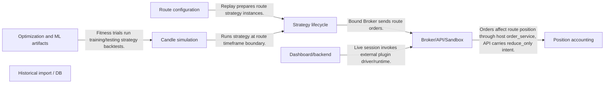
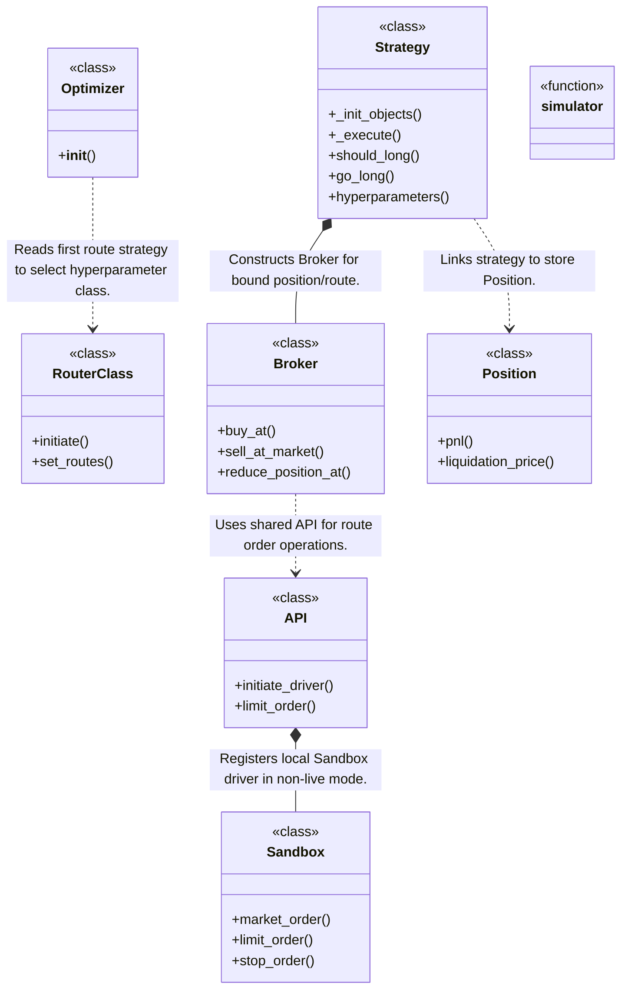
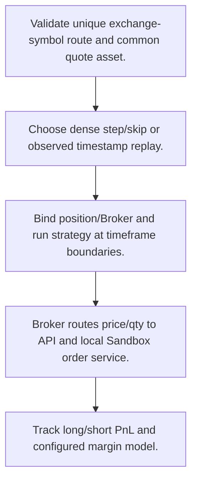
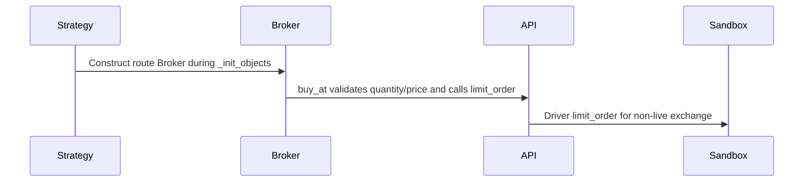

# jesse: workflow, design and architecture

Updated: **2026-10-13**
Reviewed Git hash: `37c568de9cf316a9f6cca0e471335c419237f8f0`
Branch: `feature/ayu_develop`
Source diff SHA256: `e3b0c44298fc1c149afbf4c8996fb92427ae41e4649b934ca495991b7852b855`
Scope: **Strategy-centric trading research / backend** / Maintenance: **active**
Languages: Python

[HTML edition](ayu-develop.html) / [Development](development.md) / [Historical validation](validation.md) / [Full system comparison](../../docs/index.html)

## Purpose and scope

Run strategy/route-based candle backtests and parameter optimization, expose dashboard APIs and delegate live/paper exchange sessions to the separate jesse-live plugin.

## Features and support boundaries

Native = implemented here. Integration = supplied through a named host/API. Limited = material restriction. Not provided = evidenced scope exclusion. Unverified = support/absence not established. Not applicable = outside this artifact type.

| Capability | Status | Implementation and limits | Source |
|---|---|---|---|
| Backtesting | Native | Native route/strategy/Broker/Sandbox and stateful candle replay provide historical execution/accounting hooks; risk is strategy/margin-oriented rather than centralized comprehensive risk policy. | [RouterClass.initiate](../src/jesse/routes/__init__.py) ([L19](https://github.com/alexcwyu/jesse/blob/37c568de9cf316a9f6cca0e471335c419237f8f0/src/jesse/routes/__init__.py#L19)) / [Strategy._execute](../src/jesse/strategies/Strategy.py) ([L1345](https://github.com/alexcwyu/jesse/blob/37c568de9cf316a9f6cca0e471335c419237f8f0/src/jesse/strategies/Strategy.py#L1345)) / [Broker.buy_at](../src/jesse/services/broker.py) ([L67](https://github.com/alexcwyu/jesse/blob/37c568de9cf316a9f6cca0e471335c419237f8f0/src/jesse/services/broker.py#L67)) / [Sandbox.limit_order](../src/jesse/exchanges/sandbox/Sandbox.py) ([L27](https://github.com/alexcwyu/jesse/blob/37c568de9cf316a9f6cca0e471335c419237f8f0/src/jesse/exchanges/sandbox/Sandbox.py#L27)) / [_timestamp_simulator](../src/jesse/modes/backtest_mode.py) ([L910](https://github.com/alexcwyu/jesse/blob/37c568de9cf316a9f6cca0e471335c419237f8f0/src/jesse/modes/backtest_mode.py#L910)) / [Position.pnl](../src/jesse/models/Position.py) ([L152](https://github.com/alexcwyu/jesse/blob/37c568de9cf316a9f6cca0e471335c419237f8f0/src/jesse/models/Position.py#L152)) / [Position.liquidation_price](../src/jesse/models/Position.py) ([L216](https://github.com/alexcwyu/jesse/blob/37c568de9cf316a9f6cca0e471335c419237f8f0/src/jesse/models/Position.py#L216)) |
| Live execution | Integration | Live endpoint explicitly imports jesse-live runtime and selects live or paper mode. Plugin is a separate dependency, not core-owned connector implementation. | [live](../src/jesse/controllers/live_controller.py) ([L33](https://github.com/alexcwyu/jesse/blob/37c568de9cf316a9f6cca0e471335c419237f8f0/src/jesse/controllers/live_controller.py#L33)) / [API.initiate_driver](../src/jesse/services/api.py) ([L30](https://github.com/alexcwyu/jesse/blob/37c568de9cf316a9f6cca0e471335c419237f8f0/src/jesse/services/api.py#L30)) |
| Paper trading | Integration | Live endpoint explicitly imports jesse-live runtime and selects live or paper mode. Plugin is a separate dependency, not core-owned connector implementation. | [live](../src/jesse/controllers/live_controller.py) ([L33](https://github.com/alexcwyu/jesse/blob/37c568de9cf316a9f6cca0e471335c419237f8f0/src/jesse/controllers/live_controller.py#L33)) / [API.initiate_driver](../src/jesse/services/api.py) ([L30](https://github.com/alexcwyu/jesse/blob/37c568de9cf316a9f6cca0e471335c419237f8f0/src/jesse/services/api.py#L30)) |
| Event driven | Native | Native route/strategy/Broker/Sandbox and stateful candle replay provide historical execution/accounting hooks; risk is strategy/margin-oriented rather than centralized comprehensive risk policy. | [RouterClass.initiate](../src/jesse/routes/__init__.py) ([L19](https://github.com/alexcwyu/jesse/blob/37c568de9cf316a9f6cca0e471335c419237f8f0/src/jesse/routes/__init__.py#L19)) / [Strategy._execute](../src/jesse/strategies/Strategy.py) ([L1345](https://github.com/alexcwyu/jesse/blob/37c568de9cf316a9f6cca0e471335c419237f8f0/src/jesse/strategies/Strategy.py#L1345)) / [Broker.buy_at](../src/jesse/services/broker.py) ([L67](https://github.com/alexcwyu/jesse/blob/37c568de9cf316a9f6cca0e471335c419237f8f0/src/jesse/services/broker.py#L67)) / [Sandbox.limit_order](../src/jesse/exchanges/sandbox/Sandbox.py) ([L27](https://github.com/alexcwyu/jesse/blob/37c568de9cf316a9f6cca0e471335c419237f8f0/src/jesse/exchanges/sandbox/Sandbox.py#L27)) / [_timestamp_simulator](../src/jesse/modes/backtest_mode.py) ([L910](https://github.com/alexcwyu/jesse/blob/37c568de9cf316a9f6cca0e471335c419237f8f0/src/jesse/modes/backtest_mode.py#L910)) / [Position.pnl](../src/jesse/models/Position.py) ([L152](https://github.com/alexcwyu/jesse/blob/37c568de9cf316a9f6cca0e471335c419237f8f0/src/jesse/models/Position.py#L152)) / [Position.liquidation_price](../src/jesse/models/Position.py) ([L216](https://github.com/alexcwyu/jesse/blob/37c568de9cf316a9f6cca0e471335c419237f8f0/src/jesse/models/Position.py#L216)) |
| Vectorized | Limited | NumPy indicator wrappers operate on arrays; strategy/order replay remains event/timeframe driven. | [rsi](../src/jesse/indicators/rsi.py) ([L9](https://github.com/alexcwyu/jesse/blob/37c568de9cf316a9f6cca0e471335c419237f8f0/src/jesse/indicators/rsi.py#L9)) / [_execute_routes](../src/jesse/modes/backtest_mode.py) ([L2232](https://github.com/alexcwyu/jesse/blob/37c568de9cf316a9f6cca0e471335c419237f8f0/src/jesse/modes/backtest_mode.py#L2232)) |
| Order management | Native | Native route/strategy/Broker/Sandbox and stateful candle replay provide historical execution/accounting hooks; risk is strategy/margin-oriented rather than centralized comprehensive risk policy. | [RouterClass.initiate](../src/jesse/routes/__init__.py) ([L19](https://github.com/alexcwyu/jesse/blob/37c568de9cf316a9f6cca0e471335c419237f8f0/src/jesse/routes/__init__.py#L19)) / [Strategy._execute](../src/jesse/strategies/Strategy.py) ([L1345](https://github.com/alexcwyu/jesse/blob/37c568de9cf316a9f6cca0e471335c419237f8f0/src/jesse/strategies/Strategy.py#L1345)) / [Broker.buy_at](../src/jesse/services/broker.py) ([L67](https://github.com/alexcwyu/jesse/blob/37c568de9cf316a9f6cca0e471335c419237f8f0/src/jesse/services/broker.py#L67)) / [Sandbox.limit_order](../src/jesse/exchanges/sandbox/Sandbox.py) ([L27](https://github.com/alexcwyu/jesse/blob/37c568de9cf316a9f6cca0e471335c419237f8f0/src/jesse/exchanges/sandbox/Sandbox.py#L27)) / [_timestamp_simulator](../src/jesse/modes/backtest_mode.py) ([L910](https://github.com/alexcwyu/jesse/blob/37c568de9cf316a9f6cca0e471335c419237f8f0/src/jesse/modes/backtest_mode.py#L910)) / [Position.pnl](../src/jesse/models/Position.py) ([L152](https://github.com/alexcwyu/jesse/blob/37c568de9cf316a9f6cca0e471335c419237f8f0/src/jesse/models/Position.py#L152)) / [Position.liquidation_price](../src/jesse/models/Position.py) ([L216](https://github.com/alexcwyu/jesse/blob/37c568de9cf316a9f6cca0e471335c419237f8f0/src/jesse/models/Position.py#L216)) |
| Order types | Native | Native route/strategy/Broker/Sandbox and stateful candle replay provide historical execution/accounting hooks; risk is strategy/margin-oriented rather than centralized comprehensive risk policy. | [RouterClass.initiate](../src/jesse/routes/__init__.py) ([L19](https://github.com/alexcwyu/jesse/blob/37c568de9cf316a9f6cca0e471335c419237f8f0/src/jesse/routes/__init__.py#L19)) / [Strategy._execute](../src/jesse/strategies/Strategy.py) ([L1345](https://github.com/alexcwyu/jesse/blob/37c568de9cf316a9f6cca0e471335c419237f8f0/src/jesse/strategies/Strategy.py#L1345)) / [Broker.buy_at](../src/jesse/services/broker.py) ([L67](https://github.com/alexcwyu/jesse/blob/37c568de9cf316a9f6cca0e471335c419237f8f0/src/jesse/services/broker.py#L67)) / [Sandbox.limit_order](../src/jesse/exchanges/sandbox/Sandbox.py) ([L27](https://github.com/alexcwyu/jesse/blob/37c568de9cf316a9f6cca0e471335c419237f8f0/src/jesse/exchanges/sandbox/Sandbox.py#L27)) / [_timestamp_simulator](../src/jesse/modes/backtest_mode.py) ([L910](https://github.com/alexcwyu/jesse/blob/37c568de9cf316a9f6cca0e471335c419237f8f0/src/jesse/modes/backtest_mode.py#L910)) / [Position.pnl](../src/jesse/models/Position.py) ([L152](https://github.com/alexcwyu/jesse/blob/37c568de9cf316a9f6cca0e471335c419237f8f0/src/jesse/models/Position.py#L152)) / [Position.liquidation_price](../src/jesse/models/Position.py) ([L216](https://github.com/alexcwyu/jesse/blob/37c568de9cf316a9f6cca0e471335c419237f8f0/src/jesse/models/Position.py#L216)) |
| Multi venue | Limited | Historical routes may include multiple exchanges with common quote; live sessions delegate one selected exchange/runtime to plugin. | [RouterClass.initiate](../src/jesse/routes/__init__.py) ([L19](https://github.com/alexcwyu/jesse/blob/37c568de9cf316a9f6cca0e471335c419237f8f0/src/jesse/routes/__init__.py#L19)) / [live](../src/jesse/controllers/live_controller.py) ([L33](https://github.com/alexcwyu/jesse/blob/37c568de9cf316a9f6cca0e471335c419237f8f0/src/jesse/controllers/live_controller.py#L33)) |
| Crypto | Limited | Route/order core is exchange-name driven; Position has native long/short/isolated-margin models, while real contract/venue behavior is supplied by plugin. | [RouterClass.initiate](../src/jesse/routes/__init__.py) ([L19](https://github.com/alexcwyu/jesse/blob/37c568de9cf316a9f6cca0e471335c419237f8f0/src/jesse/routes/__init__.py#L19)) / [Position.liquidation_price](../src/jesse/models/Position.py) ([L216](https://github.com/alexcwyu/jesse/blob/37c568de9cf316a9f6cca0e471335c419237f8f0/src/jesse/models/Position.py#L216)) / [live](../src/jesse/controllers/live_controller.py) ([L33](https://github.com/alexcwyu/jesse/blob/37c568de9cf316a9f6cca0e471335c419237f8f0/src/jesse/controllers/live_controller.py#L33)) |
| Equities | Unverified | Representative source review did not establish this capability; no claim of absence. | Not applicable to this repository scope. |
| Futures | Limited | Route/order core is exchange-name driven; Position has native long/short/isolated-margin models, while real contract/venue behavior is supplied by plugin. | [RouterClass.initiate](../src/jesse/routes/__init__.py) ([L19](https://github.com/alexcwyu/jesse/blob/37c568de9cf316a9f6cca0e471335c419237f8f0/src/jesse/routes/__init__.py#L19)) / [Position.liquidation_price](../src/jesse/models/Position.py) ([L216](https://github.com/alexcwyu/jesse/blob/37c568de9cf316a9f6cca0e471335c419237f8f0/src/jesse/models/Position.py#L216)) / [live](../src/jesse/controllers/live_controller.py) ([L33](https://github.com/alexcwyu/jesse/blob/37c568de9cf316a9f6cca0e471335c419237f8f0/src/jesse/controllers/live_controller.py#L33)) |
| Options | Unverified | Representative source review did not establish this capability; no claim of absence. | Not applicable to this repository scope. |
| Forex | Unverified | Representative source review did not establish this capability; no claim of absence. | Not applicable to this repository scope. |
| Strategy api | Native | Native route/strategy/Broker/Sandbox and stateful candle replay provide historical execution/accounting hooks; risk is strategy/margin-oriented rather than centralized comprehensive risk policy. | [RouterClass.initiate](../src/jesse/routes/__init__.py) ([L19](https://github.com/alexcwyu/jesse/blob/37c568de9cf316a9f6cca0e471335c419237f8f0/src/jesse/routes/__init__.py#L19)) / [Strategy._execute](../src/jesse/strategies/Strategy.py) ([L1345](https://github.com/alexcwyu/jesse/blob/37c568de9cf316a9f6cca0e471335c419237f8f0/src/jesse/strategies/Strategy.py#L1345)) / [Broker.buy_at](../src/jesse/services/broker.py) ([L67](https://github.com/alexcwyu/jesse/blob/37c568de9cf316a9f6cca0e471335c419237f8f0/src/jesse/services/broker.py#L67)) / [Sandbox.limit_order](../src/jesse/exchanges/sandbox/Sandbox.py) ([L27](https://github.com/alexcwyu/jesse/blob/37c568de9cf316a9f6cca0e471335c419237f8f0/src/jesse/exchanges/sandbox/Sandbox.py#L27)) / [_timestamp_simulator](../src/jesse/modes/backtest_mode.py) ([L910](https://github.com/alexcwyu/jesse/blob/37c568de9cf316a9f6cca0e471335c419237f8f0/src/jesse/modes/backtest_mode.py#L910)) / [Position.pnl](../src/jesse/models/Position.py) ([L152](https://github.com/alexcwyu/jesse/blob/37c568de9cf316a9f6cca0e471335c419237f8f0/src/jesse/models/Position.py#L152)) / [Position.liquidation_price](../src/jesse/models/Position.py) ([L216](https://github.com/alexcwyu/jesse/blob/37c568de9cf316a9f6cca0e471335c419237f8f0/src/jesse/models/Position.py#L216)) |
| Optimization | Integration | Local optimizer orchestrates persistent Optuna study and external Ray trials; fitness runs local training/testing backtests. | [Optimizer.__init__](../src/jesse/modes/optimize_mode/Optimize.py) ([L99](https://github.com/alexcwyu/jesse/blob/37c568de9cf316a9f6cca0e471335c419237f8f0/src/jesse/modes/optimize_mode/Optimize.py#L99)) / [ray_evaluate_trial](../src/jesse/modes/optimize_mode/Optimize.py) ([L34](https://github.com/alexcwyu/jesse/blob/37c568de9cf316a9f6cca0e471335c419237f8f0/src/jesse/modes/optimize_mode/Optimize.py#L34)) |
| Machine learning | Limited | Native feature/label recording and externally fitted model/scaler prediction helpers exist; no integrated training platform established by reviewed hooks. | [Strategy.ml_predict](../src/jesse/strategies/Strategy.py) ([L300](https://github.com/alexcwyu/jesse/blob/37c568de9cf316a9f6cca0e471335c419237f8f0/src/jesse/strategies/Strategy.py#L300)) / [Strategy.record_features](../src/jesse/strategies/Strategy.py) ([L123](https://github.com/alexcwyu/jesse/blob/37c568de9cf316a9f6cca0e471335c419237f8f0/src/jesse/strategies/Strategy.py#L123)) |
| Reinforcement learning | Unverified | Representative source review did not establish this capability; no claim of absence. | Not applicable to this repository scope. |
| Portfolio | Native | Native route/strategy/Broker/Sandbox and stateful candle replay provide historical execution/accounting hooks; risk is strategy/margin-oriented rather than centralized comprehensive risk policy. | [RouterClass.initiate](../src/jesse/routes/__init__.py) ([L19](https://github.com/alexcwyu/jesse/blob/37c568de9cf316a9f6cca0e471335c419237f8f0/src/jesse/routes/__init__.py#L19)) / [Strategy._execute](../src/jesse/strategies/Strategy.py) ([L1345](https://github.com/alexcwyu/jesse/blob/37c568de9cf316a9f6cca0e471335c419237f8f0/src/jesse/strategies/Strategy.py#L1345)) / [Broker.buy_at](../src/jesse/services/broker.py) ([L67](https://github.com/alexcwyu/jesse/blob/37c568de9cf316a9f6cca0e471335c419237f8f0/src/jesse/services/broker.py#L67)) / [Sandbox.limit_order](../src/jesse/exchanges/sandbox/Sandbox.py) ([L27](https://github.com/alexcwyu/jesse/blob/37c568de9cf316a9f6cca0e471335c419237f8f0/src/jesse/exchanges/sandbox/Sandbox.py#L27)) / [_timestamp_simulator](../src/jesse/modes/backtest_mode.py) ([L910](https://github.com/alexcwyu/jesse/blob/37c568de9cf316a9f6cca0e471335c419237f8f0/src/jesse/modes/backtest_mode.py#L910)) / [Position.pnl](../src/jesse/models/Position.py) ([L152](https://github.com/alexcwyu/jesse/blob/37c568de9cf316a9f6cca0e471335c419237f8f0/src/jesse/models/Position.py#L152)) / [Position.liquidation_price](../src/jesse/models/Position.py) ([L216](https://github.com/alexcwyu/jesse/blob/37c568de9cf316a9f6cca0e471335c419237f8f0/src/jesse/models/Position.py#L216)) |
| Risk management | Native | Native route/strategy/Broker/Sandbox and stateful candle replay provide historical execution/accounting hooks; risk is strategy/margin-oriented rather than centralized comprehensive risk policy. | [RouterClass.initiate](../src/jesse/routes/__init__.py) ([L19](https://github.com/alexcwyu/jesse/blob/37c568de9cf316a9f6cca0e471335c419237f8f0/src/jesse/routes/__init__.py#L19)) / [Strategy._execute](../src/jesse/strategies/Strategy.py) ([L1345](https://github.com/alexcwyu/jesse/blob/37c568de9cf316a9f6cca0e471335c419237f8f0/src/jesse/strategies/Strategy.py#L1345)) / [Broker.buy_at](../src/jesse/services/broker.py) ([L67](https://github.com/alexcwyu/jesse/blob/37c568de9cf316a9f6cca0e471335c419237f8f0/src/jesse/services/broker.py#L67)) / [Sandbox.limit_order](../src/jesse/exchanges/sandbox/Sandbox.py) ([L27](https://github.com/alexcwyu/jesse/blob/37c568de9cf316a9f6cca0e471335c419237f8f0/src/jesse/exchanges/sandbox/Sandbox.py#L27)) / [_timestamp_simulator](../src/jesse/modes/backtest_mode.py) ([L910](https://github.com/alexcwyu/jesse/blob/37c568de9cf316a9f6cca0e471335c419237f8f0/src/jesse/modes/backtest_mode.py#L910)) / [Position.pnl](../src/jesse/models/Position.py) ([L152](https://github.com/alexcwyu/jesse/blob/37c568de9cf316a9f6cca0e471335c419237f8f0/src/jesse/models/Position.py#L152)) / [Position.liquidation_price](../src/jesse/models/Position.py) ([L216](https://github.com/alexcwyu/jesse/blob/37c568de9cf316a9f6cca0e471335c419237f8f0/src/jesse/models/Position.py#L216)) |
| Performance analytics | Native | Position PnL plus Sharpe/Sortino/drawdown functions and replay result outputs are local implementations. | [sharpe_ratio](../src/jesse/services/metrics.py) ([L71](https://github.com/alexcwyu/jesse/blob/37c568de9cf316a9f6cca0e471335c419237f8f0/src/jesse/services/metrics.py#L71)) / [Position.pnl](../src/jesse/models/Position.py) ([L152](https://github.com/alexcwyu/jesse/blob/37c568de9cf316a9f6cca0e471335c419237f8f0/src/jesse/models/Position.py#L152)) / [_timestamp_simulator](../src/jesse/modes/backtest_mode.py) ([L910](https://github.com/alexcwyu/jesse/blob/37c568de9cf316a9f6cca0e471335c419237f8f0/src/jesse/modes/backtest_mode.py#L910)) |
| Historical data | Integration | Native import orchestration requests provider-native one-minute batches from registered external historical drivers and stores observed rows. | [_run](../src/jesse/modes/import_candles_mode/__init__.py) ([L288](https://github.com/alexcwyu/jesse/blob/37c568de9cf316a9f6cca0e471335c419237f8f0/src/jesse/modes/import_candles_mode/__init__.py#L288)) |
| Streaming data | Integration | Live endpoint explicitly imports jesse-live runtime and selects live or paper mode. Plugin is a separate dependency, not core-owned connector implementation. | [live](../src/jesse/controllers/live_controller.py) ([L33](https://github.com/alexcwyu/jesse/blob/37c568de9cf316a9f6cca0e471335c419237f8f0/src/jesse/controllers/live_controller.py#L33)) / [API.initiate_driver](../src/jesse/services/api.py) ([L30](https://github.com/alexcwyu/jesse/blob/37c568de9cf316a9f6cca0e471335c419237f8f0/src/jesse/services/api.py#L30)) |
| Persistence | Native | Database owner connects PostgreSQL models/services; import path persists observed candles and terminal job state. Runtime DB availability was not tested. | [Database.open_connection](../src/jesse/services/db.py) ([L42](https://github.com/alexcwyu/jesse/blob/37c568de9cf316a9f6cca0e471335c419237f8f0/src/jesse/services/db.py#L42)) / [_run](../src/jesse/modes/import_candles_mode/__init__.py) ([L288](https://github.com/alexcwyu/jesse/blob/37c568de9cf316a9f6cca0e471335c419237f8f0/src/jesse/modes/import_candles_mode/__init__.py#L288)) |
| Data pipeline | Native | Native route/strategy/Broker/Sandbox and stateful candle replay provide historical execution/accounting hooks; risk is strategy/margin-oriented rather than centralized comprehensive risk policy. | [RouterClass.initiate](../src/jesse/routes/__init__.py) ([L19](https://github.com/alexcwyu/jesse/blob/37c568de9cf316a9f6cca0e471335c419237f8f0/src/jesse/routes/__init__.py#L19)) / [Strategy._execute](../src/jesse/strategies/Strategy.py) ([L1345](https://github.com/alexcwyu/jesse/blob/37c568de9cf316a9f6cca0e471335c419237f8f0/src/jesse/strategies/Strategy.py#L1345)) / [Broker.buy_at](../src/jesse/services/broker.py) ([L67](https://github.com/alexcwyu/jesse/blob/37c568de9cf316a9f6cca0e471335c419237f8f0/src/jesse/services/broker.py#L67)) / [Sandbox.limit_order](../src/jesse/exchanges/sandbox/Sandbox.py) ([L27](https://github.com/alexcwyu/jesse/blob/37c568de9cf316a9f6cca0e471335c419237f8f0/src/jesse/exchanges/sandbox/Sandbox.py#L27)) / [_timestamp_simulator](../src/jesse/modes/backtest_mode.py) ([L910](https://github.com/alexcwyu/jesse/blob/37c568de9cf316a9f6cca0e471335c419237f8f0/src/jesse/modes/backtest_mode.py#L910)) / [Position.pnl](../src/jesse/models/Position.py) ([L152](https://github.com/alexcwyu/jesse/blob/37c568de9cf316a9f6cca0e471335c419237f8f0/src/jesse/models/Position.py#L152)) / [Position.liquidation_price](../src/jesse/models/Position.py) ([L216](https://github.com/alexcwyu/jesse/blob/37c568de9cf316a9f6cca0e471335c419237f8f0/src/jesse/models/Position.py#L216)) |
| Web ui | Native | Core serves packaged static dashboard and registered FastAPI controller endpoints. | [index](../src/jesse/app.py) ([L41](https://github.com/alexcwyu/jesse/blob/37c568de9cf316a9f6cca0e471335c419237f8f0/src/jesse/app.py#L41)) |
| Cli | Native | Click project launcher owns backend shared state and starts server. | [run](../src/jesse/cli.py) ([L79](https://github.com/alexcwyu/jesse/blob/37c568de9cf316a9f6cca0e471335c419237f8f0/src/jesse/cli.py#L79)) |
| Monitoring | Native | Core serves packaged static dashboard and registered FastAPI controller endpoints. | [index](../src/jesse/app.py) ([L41](https://github.com/alexcwyu/jesse/blob/37c568de9cf316a9f6cca0e471335c419237f8f0/src/jesse/app.py#L41)) |
| Extension api | Native | Native route/strategy/Broker/Sandbox and stateful candle replay provide historical execution/accounting hooks; risk is strategy/margin-oriented rather than centralized comprehensive risk policy. | [RouterClass.initiate](../src/jesse/routes/__init__.py) ([L19](https://github.com/alexcwyu/jesse/blob/37c568de9cf316a9f6cca0e471335c419237f8f0/src/jesse/routes/__init__.py#L19)) / [Strategy._execute](../src/jesse/strategies/Strategy.py) ([L1345](https://github.com/alexcwyu/jesse/blob/37c568de9cf316a9f6cca0e471335c419237f8f0/src/jesse/strategies/Strategy.py#L1345)) / [Broker.buy_at](../src/jesse/services/broker.py) ([L67](https://github.com/alexcwyu/jesse/blob/37c568de9cf316a9f6cca0e471335c419237f8f0/src/jesse/services/broker.py#L67)) / [Sandbox.limit_order](../src/jesse/exchanges/sandbox/Sandbox.py) ([L27](https://github.com/alexcwyu/jesse/blob/37c568de9cf316a9f6cca0e471335c419237f8f0/src/jesse/exchanges/sandbox/Sandbox.py#L27)) / [_timestamp_simulator](../src/jesse/modes/backtest_mode.py) ([L910](https://github.com/alexcwyu/jesse/blob/37c568de9cf316a9f6cca0e471335c419237f8f0/src/jesse/modes/backtest_mode.py#L910)) / [Position.pnl](../src/jesse/models/Position.py) ([L152](https://github.com/alexcwyu/jesse/blob/37c568de9cf316a9f6cca0e471335c419237f8f0/src/jesse/models/Position.py#L152)) / [Position.liquidation_price](../src/jesse/models/Position.py) ([L216](https://github.com/alexcwyu/jesse/blob/37c568de9cf316a9f6cca0e471335c419237f8f0/src/jesse/models/Position.py#L216)) |
| Native acceleration | Integration | Indicator wrapper calls separate jesse_rust kernels. The Rust implementation lives in another repository. | [rsi](../src/jesse/indicators/rsi.py) ([L9](https://github.com/alexcwyu/jesse/blob/37c568de9cf316a9f6cca0e471335c419237f8f0/src/jesse/indicators/rsi.py#L9)) |
| Distributed execution | Integration | Optimization trial function is Ray remote and study initializes Ray; this proves optimization delegation, not distributed live-order coordination. | [Optimizer.__init__](../src/jesse/modes/optimize_mode/Optimize.py) ([L99](https://github.com/alexcwyu/jesse/blob/37c568de9cf316a9f6cca0e471335c419237f8f0/src/jesse/modes/optimize_mode/Optimize.py#L99)) / [ray_evaluate_trial](../src/jesse/modes/optimize_mode/Optimize.py) ([L34](https://github.com/alexcwyu/jesse/blob/37c568de9cf316a9f6cca0e471335c419237f8f0/src/jesse/modes/optimize_mode/Optimize.py#L34)) |

## System components

| Component | Responsibility | Source |
|---|---|---|
| Route configuration | Validate trading/data routes and derive required feeds. | [RouterClass.initiate](../src/jesse/routes/__init__.py) ([L19](https://github.com/alexcwyu/jesse/blob/37c568de9cf316a9f6cca0e471335c419237f8f0/src/jesse/routes/__init__.py#L19)) |
| Strategy lifecycle | Bind broker/position and execute candle entry/exit hooks. | [Strategy._init_objects](../src/jesse/strategies/Strategy.py) ([L468](https://github.com/alexcwyu/jesse/blob/37c568de9cf316a9f6cca0e471335c419237f8f0/src/jesse/strategies/Strategy.py#L468)) / [Strategy._execute](../src/jesse/strategies/Strategy.py) ([L1345](https://github.com/alexcwyu/jesse/blob/37c568de9cf316a9f6cca0e471335c419237f8f0/src/jesse/strategies/Strategy.py#L1345)) |
| Broker/API/Sandbox | Route orders to external live driver or local simulation. | [Broker.buy_at](../src/jesse/services/broker.py) ([L67](https://github.com/alexcwyu/jesse/blob/37c568de9cf316a9f6cca0e471335c419237f8f0/src/jesse/services/broker.py#L67)) / [API.initiate_driver](../src/jesse/services/api.py) ([L30](https://github.com/alexcwyu/jesse/blob/37c568de9cf316a9f6cca0e471335c419237f8f0/src/jesse/services/api.py#L30)) / [Sandbox.limit_order](../src/jesse/exchanges/sandbox/Sandbox.py) ([L27](https://github.com/alexcwyu/jesse/blob/37c568de9cf316a9f6cca0e471335c419237f8f0/src/jesse/exchanges/sandbox/Sandbox.py#L27)) |
| Candle simulation | Dense or observed-timestamp replay with route/order timing. | [simulator](../src/jesse/modes/backtest_mode.py) ([L541](https://github.com/alexcwyu/jesse/blob/37c568de9cf316a9f6cca0e471335c419237f8f0/src/jesse/modes/backtest_mode.py#L541)) / [_timestamp_simulator](../src/jesse/modes/backtest_mode.py) ([L910](https://github.com/alexcwyu/jesse/blob/37c568de9cf316a9f6cca0e471335c419237f8f0/src/jesse/modes/backtest_mode.py#L910)) / [_execute_routes](../src/jesse/modes/backtest_mode.py) ([L2232](https://github.com/alexcwyu/jesse/blob/37c568de9cf316a9f6cca0e471335c419237f8f0/src/jesse/modes/backtest_mode.py#L2232)) |
| Optimization and ML artifacts | Optuna/Ray trials and model feature/prediction hooks. | [Optimizer.__init__](../src/jesse/modes/optimize_mode/Optimize.py) ([L99](https://github.com/alexcwyu/jesse/blob/37c568de9cf316a9f6cca0e471335c419237f8f0/src/jesse/modes/optimize_mode/Optimize.py#L99)) / [ray_evaluate_trial](../src/jesse/modes/optimize_mode/Optimize.py) ([L34](https://github.com/alexcwyu/jesse/blob/37c568de9cf316a9f6cca0e471335c419237f8f0/src/jesse/modes/optimize_mode/Optimize.py#L34)) / [Strategy.ml_predict](../src/jesse/strategies/Strategy.py) ([L300](https://github.com/alexcwyu/jesse/blob/37c568de9cf316a9f6cca0e471335c419237f8f0/src/jesse/strategies/Strategy.py#L300)) |
| Position accounting | Position PnL/margin state for replay. | [Position.pnl](../src/jesse/models/Position.py) ([L152](https://github.com/alexcwyu/jesse/blob/37c568de9cf316a9f6cca0e471335c419237f8f0/src/jesse/models/Position.py#L152)) / [Position.liquidation_price](../src/jesse/models/Position.py) ([L216](https://github.com/alexcwyu/jesse/blob/37c568de9cf316a9f6cca0e471335c419237f8f0/src/jesse/models/Position.py#L216)) |
| Dashboard/backend | Serve static UI/APIs and delegate live/paper session. | [index](../src/jesse/app.py) ([L41](https://github.com/alexcwyu/jesse/blob/37c568de9cf316a9f6cca0e471335c419237f8f0/src/jesse/app.py#L41)) / [live](../src/jesse/controllers/live_controller.py) ([L33](https://github.com/alexcwyu/jesse/blob/37c568de9cf316a9f6cca0e471335c419237f8f0/src/jesse/controllers/live_controller.py#L33)) |
| Historical import / DB | Fetch native observed candle ranges and persist through configured PostgreSQL model/repository. | [_run](../src/jesse/modes/import_candles_mode/__init__.py) ([L288](https://github.com/alexcwyu/jesse/blob/37c568de9cf316a9f6cca0e471335c419237f8f0/src/jesse/modes/import_candles_mode/__init__.py#L288)) / [Database.open_connection](../src/jesse/services/db.py) ([L42](https://github.com/alexcwyu/jesse/blob/37c568de9cf316a9f6cca0e471335c419237f8f0/src/jesse/services/db.py#L42)) |

## Architecture and component boundaries

The component view summarizes inspected responsibility boundaries. Arrows identify the documented API/data dependencies; this is not a deployment-readiness claim.

- Replay prepares route strategy instances.: [RouterClass.initiate](../src/jesse/routes/__init__.py) ([L19](https://github.com/alexcwyu/jesse/blob/37c568de9cf316a9f6cca0e471335c419237f8f0/src/jesse/routes/__init__.py#L19)) / [_timestamp_simulator](../src/jesse/modes/backtest_mode.py) ([L910](https://github.com/alexcwyu/jesse/blob/37c568de9cf316a9f6cca0e471335c419237f8f0/src/jesse/modes/backtest_mode.py#L910))
- Runs strategy at route timeframe boundary.: [_execute_routes](../src/jesse/modes/backtest_mode.py) ([L2232](https://github.com/alexcwyu/jesse/blob/37c568de9cf316a9f6cca0e471335c419237f8f0/src/jesse/modes/backtest_mode.py#L2232))
- Bound Broker sends route orders.: [Strategy._init_objects](../src/jesse/strategies/Strategy.py) ([L468](https://github.com/alexcwyu/jesse/blob/37c568de9cf316a9f6cca0e471335c419237f8f0/src/jesse/strategies/Strategy.py#L468)) / [Broker.buy_at](../src/jesse/services/broker.py) ([L67](https://github.com/alexcwyu/jesse/blob/37c568de9cf316a9f6cca0e471335c419237f8f0/src/jesse/services/broker.py#L67))
- Orders affect route position through host order_service; API carries reduce_only intent.: [Sandbox.limit_order](../src/jesse/exchanges/sandbox/Sandbox.py) ([L27](https://github.com/alexcwyu/jesse/blob/37c568de9cf316a9f6cca0e471335c419237f8f0/src/jesse/exchanges/sandbox/Sandbox.py#L27)) / [Position.pnl](../src/jesse/models/Position.py) ([L152](https://github.com/alexcwyu/jesse/blob/37c568de9cf316a9f6cca0e471335c419237f8f0/src/jesse/models/Position.py#L152))
- Fitness trials run training/testing strategy backtests.: [ray_evaluate_trial](../src/jesse/modes/optimize_mode/Optimize.py) ([L34](https://github.com/alexcwyu/jesse/blob/37c568de9cf316a9f6cca0e471335c419237f8f0/src/jesse/modes/optimize_mode/Optimize.py#L34))
- Live session invokes external plugin driver/runtime.: [live](../src/jesse/controllers/live_controller.py) ([L33](https://github.com/alexcwyu/jesse/blob/37c568de9cf316a9f6cca0e471335c419237f8f0/src/jesse/controllers/live_controller.py#L33)) / [API.initiate_driver](../src/jesse/services/api.py) ([L30](https://github.com/alexcwyu/jesse/blob/37c568de9cf316a9f6cca0e471335c419237f8f0/src/jesse/services/api.py#L30))

## Design decisions

| Decision | Rationale | Tradeoff | Evidence |
|---|---|---|---|
| Validate route uniqueness and common quote asset. | One strategy per exchange-symbol avoids position conflicts; common quote enables comparable aggregate metrics. | Multi-route research cannot mix quote currencies without conversion changes. | [RouterClass.initiate](../src/jesse/routes/__init__.py) ([L19](https://github.com/alexcwyu/jesse/blob/37c568de9cf316a9f6cca0e471335c419237f8f0/src/jesse/routes/__init__.py#L19)) |
| Switch replay by source availability shape. | Sparse/gapped instrument histories preserve observed timestamps while dense aligned data uses legacy fast paths. | Multiple simulation paths need independent coverage; fast mode is not blanket vectorization. | [simulator](../src/jesse/modes/backtest_mode.py) ([L541](https://github.com/alexcwyu/jesse/blob/37c568de9cf316a9f6cca0e471335c419237f8f0/src/jesse/modes/backtest_mode.py#L541)) / [_timestamp_simulator](../src/jesse/modes/backtest_mode.py) ([L910](https://github.com/alexcwyu/jesse/blob/37c568de9cf316a9f6cca0e471335c419237f8f0/src/jesse/modes/backtest_mode.py#L910)) |

## Class and interface relationships

Each node is a reviewed source symbol. Function/module nodes are explicitly labeled; they do not imply Python classes. Only reviewed relationships are drawn.

- **RouterClass** (class): [RouterClass.initiate](../src/jesse/routes/__init__.py) ([L19](https://github.com/alexcwyu/jesse/blob/37c568de9cf316a9f6cca0e471335c419237f8f0/src/jesse/routes/__init__.py#L19))
- **Strategy** (class): [Strategy._execute](../src/jesse/strategies/Strategy.py) ([L1345](https://github.com/alexcwyu/jesse/blob/37c568de9cf316a9f6cca0e471335c419237f8f0/src/jesse/strategies/Strategy.py#L1345))
- **Broker** (class): [Broker.buy_at](../src/jesse/services/broker.py) ([L67](https://github.com/alexcwyu/jesse/blob/37c568de9cf316a9f6cca0e471335c419237f8f0/src/jesse/services/broker.py#L67))
- **API** (class): [API.initiate_driver](../src/jesse/services/api.py) ([L30](https://github.com/alexcwyu/jesse/blob/37c568de9cf316a9f6cca0e471335c419237f8f0/src/jesse/services/api.py#L30))
- **Sandbox** (class): [Sandbox.limit_order](../src/jesse/exchanges/sandbox/Sandbox.py) ([L27](https://github.com/alexcwyu/jesse/blob/37c568de9cf316a9f6cca0e471335c419237f8f0/src/jesse/exchanges/sandbox/Sandbox.py#L27))
- **Optimizer** (class): [Optimizer.__init__](../src/jesse/modes/optimize_mode/Optimize.py) ([L99](https://github.com/alexcwyu/jesse/blob/37c568de9cf316a9f6cca0e471335c419237f8f0/src/jesse/modes/optimize_mode/Optimize.py#L99))
- **Position** (class): [Position.pnl](../src/jesse/models/Position.py) ([L152](https://github.com/alexcwyu/jesse/blob/37c568de9cf316a9f6cca0e471335c419237f8f0/src/jesse/models/Position.py#L152))
- **simulator** (function): [simulator](../src/jesse/modes/backtest_mode.py) ([L541](https://github.com/alexcwyu/jesse/blob/37c568de9cf316a9f6cca0e471335c419237f8f0/src/jesse/modes/backtest_mode.py#L541))

## Workflow

### Route-based historical strategy run

This is native historical execution. Actual live/paper sessions require jesse-live; local Sandbox is not a live paper-trading exchange adapter.

1. Validate unique exchange-symbol route and common quote asset.. [RouterClass.initiate](../src/jesse/routes/__init__.py) ([L19](https://github.com/alexcwyu/jesse/blob/37c568de9cf316a9f6cca0e471335c419237f8f0/src/jesse/routes/__init__.py#L19))
2. Choose dense step/skip or observed timestamp replay.. [simulator](../src/jesse/modes/backtest_mode.py) ([L541](https://github.com/alexcwyu/jesse/blob/37c568de9cf316a9f6cca0e471335c419237f8f0/src/jesse/modes/backtest_mode.py#L541))
3. Bind position/Broker and run strategy at timeframe boundaries.. [Strategy._init_objects](../src/jesse/strategies/Strategy.py) ([L468](https://github.com/alexcwyu/jesse/blob/37c568de9cf316a9f6cca0e471335c419237f8f0/src/jesse/strategies/Strategy.py#L468)) / [_execute_routes](../src/jesse/modes/backtest_mode.py) ([L2232](https://github.com/alexcwyu/jesse/blob/37c568de9cf316a9f6cca0e471335c419237f8f0/src/jesse/modes/backtest_mode.py#L2232)) / [Strategy._execute](../src/jesse/strategies/Strategy.py) ([L1345](https://github.com/alexcwyu/jesse/blob/37c568de9cf316a9f6cca0e471335c419237f8f0/src/jesse/strategies/Strategy.py#L1345))
4. Broker routes price/qty to API and local Sandbox order service.. [Broker.buy_at](../src/jesse/services/broker.py) ([L67](https://github.com/alexcwyu/jesse/blob/37c568de9cf316a9f6cca0e471335c419237f8f0/src/jesse/services/broker.py#L67)) / [API.initiate_driver](../src/jesse/services/api.py) ([L30](https://github.com/alexcwyu/jesse/blob/37c568de9cf316a9f6cca0e471335c419237f8f0/src/jesse/services/api.py#L30)) / [Sandbox.limit_order](../src/jesse/exchanges/sandbox/Sandbox.py) ([L27](https://github.com/alexcwyu/jesse/blob/37c568de9cf316a9f6cca0e471335c419237f8f0/src/jesse/exchanges/sandbox/Sandbox.py#L27))
5. Track long/short PnL and configured margin model.. [Position.pnl](../src/jesse/models/Position.py) ([L152](https://github.com/alexcwyu/jesse/blob/37c568de9cf316a9f6cca0e471335c419237f8f0/src/jesse/models/Position.py#L152)) / [Position.liquidation_price](../src/jesse/models/Position.py) ([L216](https://github.com/alexcwyu/jesse/blob/37c568de9cf316a9f6cca0e471335c419237f8f0/src/jesse/models/Position.py#L216))

## Sequence

Strategy limit order through simulation API

User strategy chooses whether/when to call buy; underlying strategy order normalization and fill simulation continue through order_service.

- Construct route Broker during _init_objects: [Strategy._init_objects](../src/jesse/strategies/Strategy.py) ([L468](https://github.com/alexcwyu/jesse/blob/37c568de9cf316a9f6cca0e471335c419237f8f0/src/jesse/strategies/Strategy.py#L468))
- buy_at validates quantity/price and calls limit_order: [Broker.buy_at](../src/jesse/services/broker.py) ([L67](https://github.com/alexcwyu/jesse/blob/37c568de9cf316a9f6cca0e471335c419237f8f0/src/jesse/services/broker.py#L67))
- Driver limit_order for non-live exchange: [API.initiate_driver](../src/jesse/services/api.py) ([L30](https://github.com/alexcwyu/jesse/blob/37c568de9cf316a9f6cca0e471335c419237f8f0/src/jesse/services/api.py#L30)) / [Sandbox.limit_order](../src/jesse/exchanges/sandbox/Sandbox.py) ([L27](https://github.com/alexcwyu/jesse/blob/37c568de9cf316a9f6cca0e471335c419237f8f0/src/jesse/exchanges/sandbox/Sandbox.py#L27))

## Strengths and limits

### Strengths

- Observed-timestamp replay explicitly preserves gaps/unequal source timelines instead of assuming every instrument has a dense minute index. [simulator](../src/jesse/modes/backtest_mode.py) ([L541](https://github.com/alexcwyu/jesse/blob/37c568de9cf316a9f6cca0e471335c419237f8f0/src/jesse/modes/backtest_mode.py#L541)) / [_timestamp_simulator](../src/jesse/modes/backtest_mode.py) ([L910](https://github.com/alexcwyu/jesse/blob/37c568de9cf316a9f6cca0e471335c419237f8f0/src/jesse/modes/backtest_mode.py#L910))

### Limitations

- Live and real-time paper trading depend on jesse-live, while native Sandbox serves offline simulation. [live](../src/jesse/controllers/live_controller.py) ([L33](https://github.com/alexcwyu/jesse/blob/37c568de9cf316a9f6cca0e471335c419237f8f0/src/jesse/controllers/live_controller.py#L33)) / [API.initiate_driver](../src/jesse/services/api.py) ([L30](https://github.com/alexcwyu/jesse/blob/37c568de9cf316a9f6cca0e471335c419237f8f0/src/jesse/services/api.py#L30)) / [Sandbox.limit_order](../src/jesse/exchanges/sandbox/Sandbox.py) ([L27](https://github.com/alexcwyu/jesse/blob/37c568de9cf316a9f6cca0e471335c419237f8f0/src/jesse/exchanges/sandbox/Sandbox.py#L27))
- Router rejects mixed quote assets and duplicate exchange-symbol routes. [RouterClass.initiate](../src/jesse/routes/__init__.py) ([L19](https://github.com/alexcwyu/jesse/blob/37c568de9cf316a9f6cca0e471335c419237f8f0/src/jesse/routes/__init__.py#L19))

## Validation scope

The linked validation and command records preserve actual historical runs and user-authorized exclusions. This source/document review does not rerun application tests, establish live trading readiness or rank benchmark performance. Current data, credential and runtime prerequisites remain material.

[Repository validation](validation.md) / [Executed checks](maintenance/index.md)

## Source map

| Reviewed symbol/path | Inspected responsibility | Actual file SHA256 |
|---|---|---|
| [RouterClass.initiate](../src/jesse/routes/__init__.py) ([L19](https://github.com/alexcwyu/jesse/blob/37c568de9cf316a9f6cca0e471335c419237f8f0/src/jesse/routes/__init__.py#L19)) | Builds routes/data routes, rejects duplicate exchange-symbol routes and mixed quote assets, derives required exchanges/timeframes/symbols. | `d456a74891714a3e9d956d6c35920c3970354cd0b87a1ece37e9c464d5de2b18` |
| [Strategy._init_objects](../src/jesse/strategies/Strategy.py) ([L468](https://github.com/alexcwyu/jesse/blob/37c568de9cf316a9f6cca0e471335c419237f8f0/src/jesse/strategies/Strategy.py#L468)) | Obtains position from store, links strategy and constructs Broker for route identity. | `bd839d7e82ef6bc66061f50017a7d4850b6f75251e5ba09e2223fe10e54dd06e` |
| [Strategy._execute](../src/jesse/strategies/Strategy.py) ([L1345](https://github.com/alexcwyu/jesse/blob/37c568de9cf316a9f6cca0e471335c419237f8f0/src/jesse/strategies/Strategy.py#L1345)) | Guards reentrancy, caches current price, executes before/_check/after, updates non-live chart, clears caches and increments index. | `bd839d7e82ef6bc66061f50017a7d4850b6f75251e5ba09e2223fe10e54dd06e` |
| [Broker.buy_at](../src/jesse/services/broker.py) ([L67](https://github.com/alexcwyu/jesse/blob/37c568de9cf316a9f6cca0e471335c419237f8f0/src/jesse/services/broker.py#L67)) | Validates nonnegative price and quantity then calls API.limit_order for route exchange/symbol. | `5aaff5e99bec709cc68e4d75d77caca28ba342d1da7821067e69d9014f697470` |
| [API.initiate_driver](../src/jesse/services/api.py) ([L30](https://github.com/alexcwyu/jesse/blob/37c568de9cf316a9f6cca0e471335c419237f8f0/src/jesse/services/api.py#L30)) | Creates external configured live driver in thread when live; otherwise local Sandbox per exchange. | `fac9e5bafc57b340396a80dd43d0e126bb5c7ae302622f31ed2f6952d0f46d26` |
| [Sandbox.limit_order](../src/jesse/exchanges/sandbox/Sandbox.py) ([L27](https://github.com/alexcwyu/jesse/blob/37c568de9cf316a9f6cca0e471335c419237f8f0/src/jesse/exchanges/sandbox/Sandbox.py#L27)) | Creates local order via order_service with route identity, side/type/qty/price/reduce_only. | `92c1ebf94636d76389d6cd076d0759ed24f2c35d216629c55919ef3b2b2cb495` |
| [simulator](../src/jesse/modes/backtest_mode.py) ([L541](https://github.com/alexcwyu/jesse/blob/37c568de9cf316a9f6cca0e471335c419237f8f0/src/jesse/modes/backtest_mode.py#L541)) | Chooses observed-timestamp replay for nonaligned/sparse source data, or dense step/skip paths depending on fast_mode. | `9a3d585b35f567567704dd5b9401bd733712654d35ea95b734eb4070f9fa3b0c` |
| [_timestamp_simulator](../src/jesse/modes/backtest_mode.py) ([L910](https://github.com/alexcwyu/jesse/blob/37c568de9cf316a9f6cca0e471335c419237f8f0/src/jesse/modes/backtest_mode.py#L910)) | Constructs union availability timestamp events, initializes routes/warmup and iterates timestamp replay without fabricating missing source candles. | `9a3d585b35f567567704dd5b9401bd733712654d35ea95b734eb4070f9fa3b0c` |
| [_execute_routes](../src/jesse/modes/backtest_mode.py) ([L2232](https://github.com/alexcwyu/jesse/blob/37c568de9cf316a9f6cca0e471335c419237f8f0/src/jesse/modes/backtest_mode.py#L2232)) | Runs each route strategy at matching timeframe boundary then updates active orders. | `9a3d585b35f567567704dd5b9401bd733712654d35ea95b734eb4070f9fa3b0c` |
| [Optimizer.__init__](../src/jesse/modes/optimize_mode/Optimize.py) ([L99](https://github.com/alexcwyu/jesse/blob/37c568de9cf316a9f6cca0e471335c419237f8f0/src/jesse/modes/optimize_mode/Optimize.py#L99)) | Reads strategy hyperparameters, creates persistent maximizing Optuna study and initializes Ray with selected CPUs. | `3ab8d5a62be5448653b74c96dea75d89a6c791f437e76d502abb3b3967d68b66` |
| [ray_evaluate_trial](../src/jesse/modes/optimize_mode/Optimize.py) ([L34](https://github.com/alexcwyu/jesse/blob/37c568de9cf316a9f6cca0e471335c419237f8f0/src/jesse/modes/optimize_mode/Optimize.py#L34)) | Ray remote function delegates train/test strategy trial to get_fitness and returns metrics/score. | `3ab8d5a62be5448653b74c96dea75d89a6c791f437e76d502abb3b3967d68b66` |
| [live](../src/jesse/controllers/live_controller.py) ([L33](https://github.com/alexcwyu/jesse/blob/37c568de9cf316a9f6cca0e471335c419237f8f0/src/jesse/controllers/live_controller.py#L33)) | Imports jesse_live.live_mode; chooses LIVE/PAPER mode and creates/spawns external runtime with lifecycle lock. | `3553b32792010adee9020bff34413b58a9bef6681dd6a65a51b108e82fe61245` |
| [index](../src/jesse/app.py) ([L41](https://github.com/alexcwyu/jesse/blob/37c568de9cf316a9f6cca0e471335c419237f8f0/src/jesse/app.py#L41)) | Serves packaged dashboard index; module registers API routers and mounts static assets, conditionally includes live router. | `303687170e4aa7fee3c40772d80775d39130476e7d5fb59bcd4a0be8e9c1486f` |
| [Strategy.ml_predict](../src/jesse/strategies/Strategy.py) ([L300](https://github.com/alexcwyu/jesse/blob/37c568de9cf316a9f6cca0e471335c419237f8f0/src/jesse/strategies/Strategy.py#L300)) | Loads external fitted model/scaler artifacts and applies user ml_features in sorted order before prediction. | `bd839d7e82ef6bc66061f50017a7d4850b6f75251e5ba09e2223fe10e54dd06e` |
| [Strategy.record_features](../src/jesse/strategies/Strategy.py) ([L123](https://github.com/alexcwyu/jesse/blob/37c568de9cf316a9f6cca0e471335c419237f8f0/src/jesse/strategies/Strategy.py#L123)) | Records strategy-selected features with current candle timestamp for later label/export. | `bd839d7e82ef6bc66061f50017a7d4850b6f75251e5ba09e2223fe10e54dd06e` |
| [rsi](../src/jesse/indicators/rsi.py) ([L9](https://github.com/alexcwyu/jesse/blob/37c568de9cf316a9f6cca0e471335c419237f8f0/src/jesse/indicators/rsi.py#L9)) | Dispatches NumPy source to jesse_rust full-series or scalar RSI kernel. | `a82266677770c3c3905c87000f81e662973ae6363b542816ae6af67a691cd922` |
| [Position.pnl](../src/jesse/models/Position.py) ([L152](https://github.com/alexcwyu/jesse/blob/37c568de9cf316a9f6cca0e471335c419237f8f0/src/jesse/models/Position.py#L152)) | Computes long/short position PnL from current/entry values with minimum quantity checks. | `74146190396c98ef0a22347ec4d0c006d4bc97b4324b8c47d3f12aa294cd88f7` |
| [Position.liquidation_price](../src/jesse/models/Position.py) ([L216](https://github.com/alexcwyu/jesse/blob/37c568de9cf316a9f6cca0e471335c419237f8f0/src/jesse/models/Position.py#L216)) | Non-live isolated mode uses side-specific leverage/margin liquidation formula; live value comes from external driver; cross/spot returns NaN. | `74146190396c98ef0a22347ec4d0c006d4bc97b4324b8c47d3f12aa294cd88f7` |
| [_run](../src/jesse/modes/import_candles_mode/__init__.py) ([L288](https://github.com/alexcwyu/jesse/blob/37c568de9cf316a9f6cca0e471335c419237f8f0/src/jesse/modes/import_candles_mode/__init__.py#L288)) | Validates historical provider request, fetches paginated native one-minute batches and stores observed candles through repository; does not synthesize gaps. | `517cbe3d1212747423ef63badd9176492baf574904046421a600d0db641eccb4` |
| [Database.open_connection](../src/jesse/services/db.py) ([L42](https://github.com/alexcwyu/jesse/blob/37c568de9cf316a9f6cca0e471335c419237f8f0/src/jesse/services/db.py#L42)) | Validates configured schema and opens reusable PostgreSQL connection only in a Jesse project, not unit-test/non-project mode. | `8a5f7ec74e98b8146090cad8094da19bb6f15db601c24eec29203adfac042f0d` |
| [run](../src/jesse/cli.py) ([L79](https://github.com/alexcwyu/jesse/blob/37c568de9cf316a9f6cca0e471335c419237f8f0/src/jesse/cli.py#L79)) | Click run command owns shared coordination/server state and starts project backend server. | `1de242d047947a820e0929b4c024fde04dad0f730813b85c6ec69029b106081a` |
| [sharpe_ratio](../src/jesse/services/metrics.py) ([L71](https://github.com/alexcwyu/jesse/blob/37c568de9cf316a9f6cca0e471335c419237f8f0/src/jesse/services/metrics.py#L71)) | Computes mean/std risk-adjusted return with optional autocorrelation penalty and annualization; related metrics provide drawdown/Sortino. | `2482e80ca53038111bf72d704c61ae94101202b2580320fca0e74131517974ba` |

## Documentation provenance

Review date: 2026-10-13. Full committed source HEAD: `37c568de9cf316a9f6cca0e471335c419237f8f0`. Template version: 2. 15 source files were independently hashed for this guide.

[Evidence catalog](../../docs/systems-2026-10-13/catalog.json) / [Standard template](../../docs/guidelines/APP_TEMPLATE.md)

- Read-only source audit of inventory HEAD 37c568de9cf316a9f6cca0e471335c419237f8f0; no runtime execution, credential check or live-production assertion. Existing validation records remain separate historical evidence.
- Inspected implementation/configuration coverage: src/jesse/routes/__init__.py, src/jesse/strategies/Strategy.py, src/jesse/services/broker.py, src/jesse/services/api.py, src/jesse/exchanges/sandbox/Sandbox.py, src/jesse/modes/backtest_mode.py, src/jesse/modes/optimize_mode/Optimize.py, src/jesse/controllers/live_controller.py, src/jesse/app.py, src/jesse/indicators/rsi.py, src/jesse/models/Position.py
- Source symbols and call chains are representative coverage, not exhaustive connector, strategy or product certification. Integration statuses identify dependencies that supply the runtime behavior.
- Additional inspected coverage: historical import _run pagination/storage, services/db.py project connection ownership, CLI run shared backend ownership and services/metrics.py Sharpe/Sortino calculations.
