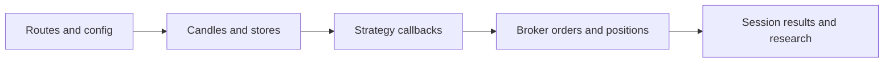
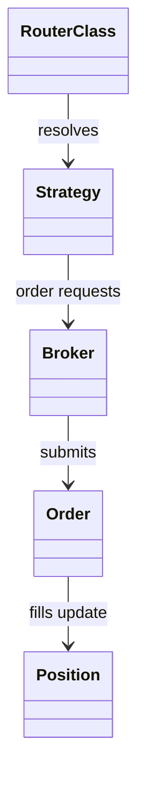
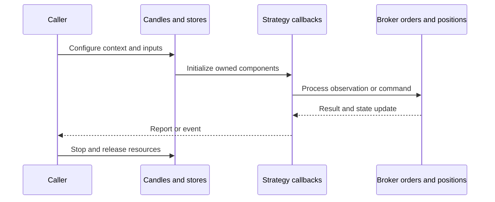
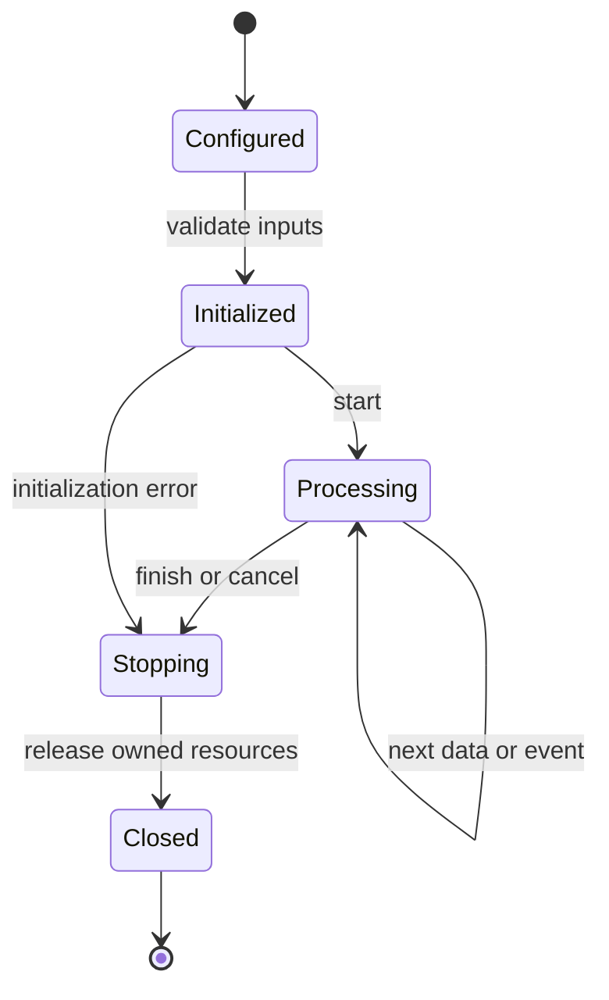
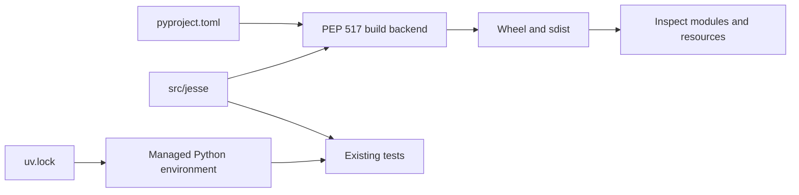
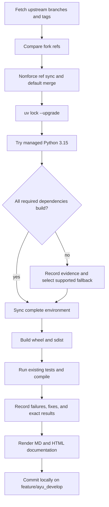

# jesse: architecture and development

Jesse runs strategy backtests, research/optimization and live-oriented services, exposing a dashboard and MCP tools. The updated upstream also uses a local native coordination service for process/session messaging.

## Components and boundaries

RouterClass validates exchange/symbol/time-frame routes and resolves strategy classes. Strategy defines entry/exit hooks; Broker manages orders and Order/Position models represent execution state. Store separates candles, orders, positions, exchanges, and application state. Backtest mode advances historical data through strategy/broker lifecycle. CoordinationClient and coordination_runtime integrate the jesse-rust service; MCP components expose research and session operations.

The following class view names implementation classes. Cross-package types are supplied by the host ecosystem; arrows describe inheritance or usage, not copied ownership.

## Runtime workflow

Validate routes and configuration, load historical candles, initialize stores and strategies, advance the simulation clock, evaluate callbacks, submit broker orders, update positions/trades and reports, and return session results. Research jobs coordinate workers through native messaging and persist results for dashboard/MCP consumption.

This sequence is an architectural view of responsibility and resource ownership. Individual plugin, connector, and strategy implementations can add asynchronous events and error branches. The lifecycle below is a conceptual operating workflow, rather than a claim that every component has one shared state enum.

## Features and extension points

Strategy lifecycle/backtesting; indicators and candle stores; spot/futures accounting; optimization and research jobs; MCP research/report tools; dashboard resources; native session coordination.

Extend the owning component behind its existing public interface. Keep metadata and configuration alongside plugin/strategy resources. Exchange-specific behavior belongs in an adapter; strategy decisions belong in the strategy/evaluator layer; persistence schema and migrations belong with the storage implementation. Review the source map below before changing a boundary, and exercise the existing tests associated with that boundary.

## Packaging and dependency design

All upstream package/dashboard resources are retained under src. Test strategy lookup uses the installed package location rather than a flat checkout path. The sibling jesse-rust source supplies the current native build; it has been ported to current PyO3/NumPy by the owning maintenance agent. Ray prevents the complete Python 3.15 environment. MCP 2 changes server APIs, so the project explicitly selects the latest compatible 1 series pending a separate API migration.

The lock records exact package versions, hashes, platform markers, and local source mappings. Path sources deliberately bind related repositories in this workspace; clone sibling repositories at the documented names before synchronization. Published packaging metadata describes public dependencies, while uv source settings select this development workspace. Resolve dependency changes with uv lock --upgrade and retain the generated lock, then verify the same locked environment.

## Maintenance workflow

All upstream branches and tags are fetched. Fork updates use nonforce pushes; a divergent branch is merged without erasing fork history. The default branch is merged into feature/ayu_develop with package/resource conflicts reconciled in their installed locations. Build and test evidence is recorded before a local maintenance commit. Feature branch publication is a separate root-level action.

No existing test assertions are removed and no new test cases are introduced in this maintenance pass. Corrected fixtures preserve coverage while making paths, corruption inputs, and resource cleanup compatible with the selected interpreter. A failed test or unsupported dependency is reported explicitly in [validation](validation.md); package build success does not imply strategy correctness, profitability, or successful live connectivity.

## Source map

| Source | Responsibility and location |
| --- | --- |
| [__init__.py](../src/jesse/routes/__init__.py) | src/jesse/routes/__init__.py |
| [Strategy.py](../src/jesse/strategies/Strategy.py) | src/jesse/strategies/Strategy.py |
| [broker.py](../src/jesse/services/broker.py) | src/jesse/services/broker.py |
| [Order.py](../src/jesse/models/Order.py) | src/jesse/models/Order.py |
| [Position.py](../src/jesse/models/Position.py) | src/jesse/models/Position.py |
| [state_candles.py](../src/jesse/store/state_candles.py) | src/jesse/store/state_candles.py |
| [backtest_mode.py](../src/jesse/modes/backtest_mode.py) | src/jesse/modes/backtest_mode.py |
| [coordination_client.py](../src/jesse/services/coordination_client.py) | src/jesse/services/coordination_client.py |
| [coordination_runtime.py](../src/jesse/services/coordination_runtime.py) | src/jesse/services/coordination_runtime.py |
| [session_results.py](../src/jesse/services/session_results.py) | src/jesse/services/session_results.py |
| [pyproject.toml](../pyproject.toml) | pyproject.toml |
| [uv.lock](../uv.lock) | uv.lock |
| [README.md](../README.md) | README.md |
| [conftest.py](../tests/conftest.py) | tests/conftest.py |

## Further reading

Use [development.md](development.md) for reproducible commands and [validation.md](validation.md) for exact interpreter, dependency, build, test, and blocker evidence. The equivalent [HTML architecture document](ayu-develop.html) supports browsing and rendered diagrams.
